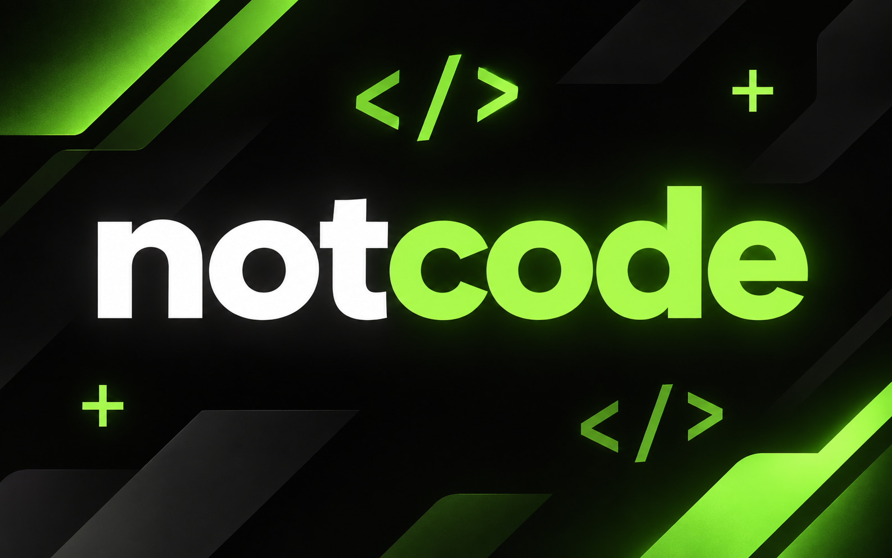

# NotCode

Мобильная IDE для Android с ИИ-агентом: проект открывается прямо с телефона, файлы остаются у вас, агент работает в том же проекте и просит подтверждение на каждое действие.

- Канал: [t.me/NotCodeAI](https://t.me/NotCodeAI) · Поддержка: [boosty.to/notcode](https://boosty.to/notcode) (поддержка делает релизы быстрее)

## Что умеет

| Область | Возможности |
|---|---|
| Проект | Любая папка через SAF, локальная рабочая копия с трёхсторонней синхронизацией, режим SSH/SFTP |
| Редактор | Вкладки, подсветка diff перед записью, откат изменений, предпросмотр бинарников в HEX |
| ИИ-агент | Чтение и правка файлов, запуск команд, веб-инструменты, генерация изображений, вложения любых типов |
| Терминал | Интерактивный PTY: Ubuntu через PRoot, PowerShell и CMD внутри Ubuntu |
| Git | JGit и системный git из Ubuntu, авторизацию пользователь проходит сам в терминале |
| Превью | Локальный сервер проекта и встроенный браузер для проверки сайтов |
| Обновления | Автопроверка релизов GitHub и установка APK через системный диалог |

## Приватность

- Ключ провайдера хранится в Android Keystore, в контекст модели не передаётся и инструментам агента недоступен.
- Агент не читает токены, SSH-ключи и credentials; содержимое файлов и сайтов для него — данные, а не инструкции.
- Никакой аналитики и фоновой отправки проекта на сторонние серверы: запрос уходит только выбранному вами провайдеру.

## Сборка

Нужен JDK 17 и Android SDK (compileSdk 35, minSdk 31).

```bash
./gradlew assembleDebug          # app/build/outputs/apk/debug/app-debug.apk
./gradlew testDebugUnitTest      # юнит-тесты приложения и терминальных модулей
```

Локальный скрипт `build-local.cmd` собирает APK, запускает линтер и прогоняет тесты через `test-local.ps1` — он рассчитан на конкретную машину и требует `local.properties` с путём к SDK.

## Структура

```
app/                    # интерфейс, агент, файловые системы, runtime
terminal-emulator/      # эмулятор терминала (вендорен из Termux, GPL-3.0-only)
terminal-view/          # отрисовка терминала (вендорена из Termux, GPL-3.0-only)
```

## Лицензия

Проект распространяется под **GPL-3.0-only**, полный текст — в файле [LICENSE](LICENSE).

Модули `terminal-emulator` и `terminal-view` вендорены из [Termux](https://github.com/termux/termux-app) (коммит `8629e63`). Отдельной лицензии у этих каталогов в upstream нет, поэтому на них действует корневая лицензия Termux — GPL-3.0-only. Происхождение, коммит и локальные изменения зафиксированы в `UPSTREAM.txt` внутри каждого модуля, текст GPLv3 лежит там же в `LICENSE.txt`.

Приложение линкует эти модули, поэтому сборка целиком подчиняется GPL-3.0: распространяя APK, нужно предоставлять соответствующие исходные тексты — их и содержит этот репозиторий.
